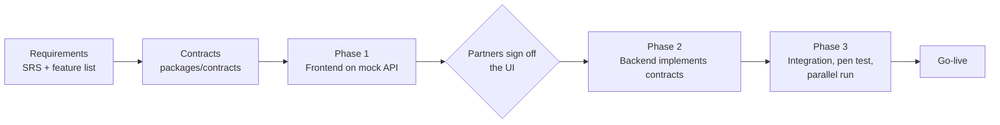

# Project overview

**Pitchforge ERP replaces spreadsheets with one system where every taka is traceable to a project, a person and a source document.** It is built in-house as a custom application, frontend first, then backend, with security treated as a release gate in every phase.

## Goals

1. **One source of truth.** Every financial event is entered once and posts automatically to a double-entry ledger.
2. **Real profit at any moment.** Company and project P&L, balance sheet and cash position in under 5 seconds, accurate to the taka.
3. **Full traceability.** Every number drills down to its journal entry, document, approver and attachment.
4. **Partner clarity.** Each partner's capital, current account and profit share is always known.
5. **Nothing slips.** Tender deadlines, milestones, invoices, renewals and bank guarantees trigger reminders.
6. **Audit-ready.** Immutable ledger and tamper-evident audit log.

## Scope

| Module                 | Includes                                                                                                       |
| ---------------------- | -------------------------------------------------------------------------------------------------------------- |
| Core platform          | Login with 2FA, roles and permissions, approval engine, notifications, audit log, documents, numbering, search |
| CRM and sales          | Leads, pipeline, quotations, contracts, tenders and bank guarantees                                            |
| Billing                | Invoices, receipts with AIT/VDS, receivables ageing                                                            |
| Accounting             | Chart of accounts, posting engine, payables, payment runs, bank reconciliation, tax, period close              |
| Partners               | Capital, drawings, profit distribution, equity history                                                         |
| Projects               | Projects, milestones, tasks, timesheets, project costing                                                       |
| HR and payroll         | Employees, attendance, leave, payroll, payslips, self-service                                                  |
| Procurement and assets | Requisitions, POs, goods receipt, inventory, fixed assets, licences                                            |
| Reports                | 9 statutory and management reports, dashboards by role                                                         |
| Administration         | Periods, approval rules, tax tables, posting rules, users                                                      |

**Out of scope for v1:** native mobile apps (a PWA is in scope), automatic bank or MFS API sync (statement import is in scope), e-GP automation, manufacturing.

## How the work flows

## Team

| Role                                     | People (FTE) | Main phases                     |
| ---------------------------------------- | ------------ | ------------------------------- |
| Tech lead / architect                    | 1            | All                             |
| Frontend developers                      | 2            | 0–1, then help with integration |
| Backend developers                       | 2            | 0 (contracts), 2–3              |
| QA engineer                              | 1            | 1–3                             |
| UI/UX designer                           | 0.5          | 0–1                             |
| Business analyst (accounting, HR)        | 0.5          | 0–3                             |
| DevOps / security (part-time or service) | 0.25         | All                             |

## Key documents

- [SRS summary](01-requirements/srs-summary.md) and [feature list](01-requirements/feature-list.md)
- [Architecture overview](02-architecture/architecture-overview.md)
- [Roadmap](03-development-phases/roadmap.md)
- [Security architecture](04-security/security-architecture.md)
- [Prototype](07-prototype/README.md)

## Open decisions

Tracked in the SRS (Section 17). The ones that block Phase 0: partnership deed rules for profit sharing, chart of accounts and opening balance date, approval thresholds, hosting region and data residency, in-house vs outsourced team.
