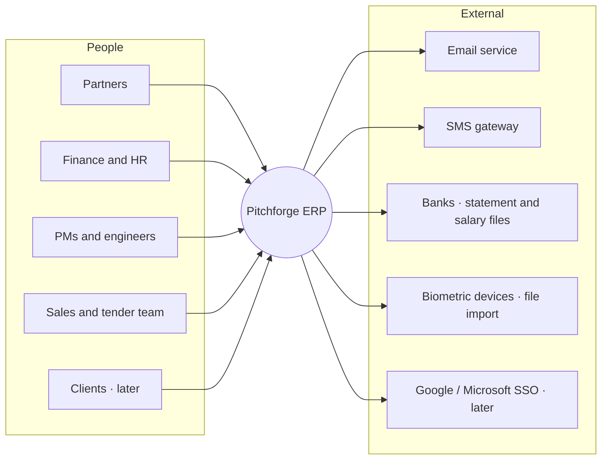
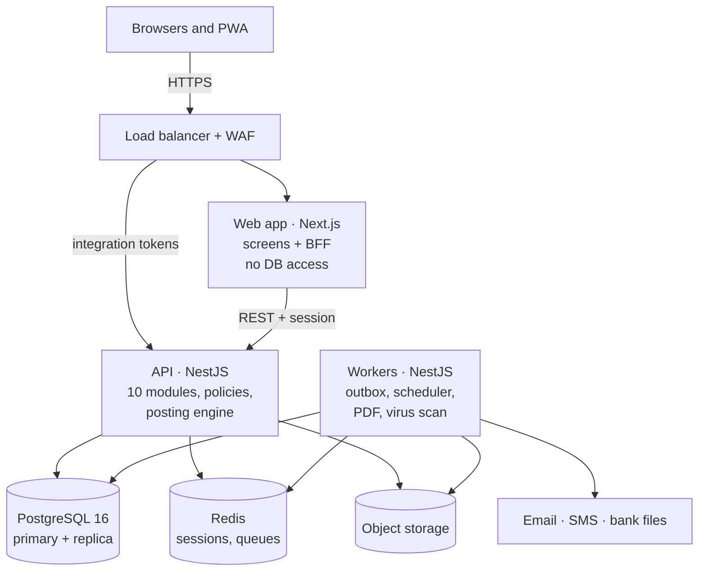
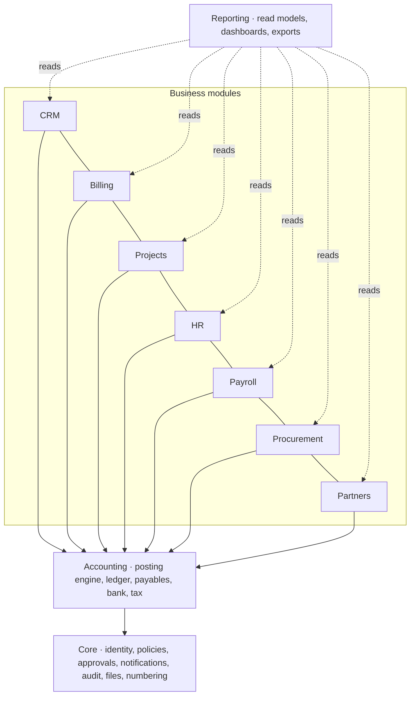
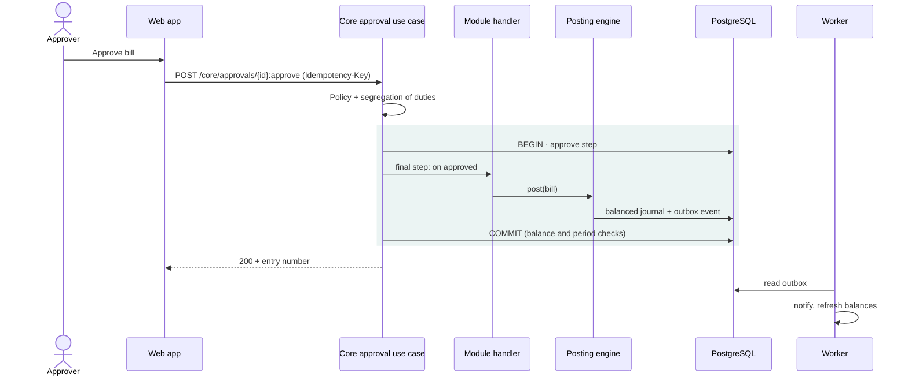

# Architecture overview

**Pitchforge ERP is a modular monolith in TypeScript: a Next.js web app, a NestJS API and NestJS workers, sharing one PostgreSQL database with one schema per module.** A single posting engine writes every financial effect to an immutable double-entry ledger. One database transaction can therefore cover the approval, the journal and the outbound event, which matters more for an ERP than independent scaling.

Full rationale: [ADR-0001](adr/0001-modular-monolith.md). Detailed version: _Software Architecture Document v1.0_.

## 1. System context

No external service is on the critical path for recording money. If email or SMS is down, work continues and messages queue.

## 2. Containers

| Container      | Technology                          | State                         | Scales by                             |
| -------------- | ----------------------------------- | ----------------------------- | ------------------------------------- |
| Web app        | Next.js, React, TypeScript          | Stateless                     | More containers                       |
| API            | NestJS                              | Stateless (sessions in Redis) | More containers, PgBouncer            |
| Workers        | NestJS, BullMQ, Gotenberg, ClamAV   | Stateless                     | More workers per queue                |
| PostgreSQL     | Managed, Multi-AZ, PITR             | System of record              | Bigger instance, replicas, partitions |
| Redis          | Managed, Multi-AZ                   | Rebuildable                   | Bigger node                           |
| Object storage | S3-compatible, versioned, encrypted | Files                         | Unlimited                             |

**The web app holds no database credentials.** A flaw in the UI layer cannot read data directly.

## 3. Module layers

Dependencies point down only. Business modules never call each other; they react to events. Rules: [module boundaries](module-boundaries.md).

## 4. The money path

Approval, journal and event commit together or not at all. Every approval takes this path; the module that owns the document registers the handler, so core never imports it ([ADR-0007](adr/0007-approvals-through-core.md)).

## 5. Key decisions

| ADR                                                | Decision                                                       |
| -------------------------------------------------- | -------------------------------------------------------------- |
| [0001](adr/0001-modular-monolith.md)               | Modular monolith, not microservices                            |
| [0002](adr/0002-frontend-first-contract-first.md)  | Frontend first, on shared contracts and a mock API             |
| [0003](adr/0003-double-entry-ledger.md)            | Double-entry ledger with one posting engine; immutable journal |
| [0004](adr/0004-server-side-sessions.md)           | Server-side sessions, not JWT in the browser                   |
| [0005](adr/0005-audit-by-database-trigger.md)      | Audit by database triggers with a hash chain                   |
| [0006](adr/0006-runtime-and-toolchain-baseline.md) | Node 26 LTS, TypeScript 6.0, pnpm 12, 7-day release cooldown   |
| [0007](adr/0007-approvals-through-core.md)         | Every approval decision goes through core                      |
| [0008](adr/0008-mock-transport-in-the-bff.md)      | Mock API inside the backend-for-frontend                       |

## 6. Stack

| Layer               | Choice                                                                                                     |
| ------------------- | ---------------------------------------------------------------------------------------------------------- |
| Front end           | Next.js (App Router), TypeScript, Tailwind CSS, shadcn/ui, TanStack Query and Table, React Hook Form + Zod |
| Mock API (Phase 1)  | Mock Service Worker serving `packages/contracts`                                                           |
| Back end            | NestJS, TypeScript; Prisma or Drizzle for CRUD, hand-written SQL for ledger and reports                    |
| Database            | PostgreSQL 16                                                                                              |
| Jobs and events     | Redis + BullMQ, transactional outbox                                                                       |
| Authorisation       | CASL policies compiled to SQL                                                                              |
| Files and documents | S3-compatible storage, ClamAV, Gotenberg PDF, ExcelJS                                                      |
| Infrastructure      | Docker, Terraform, AWS (Singapore or Mumbai) or a Bangladesh data centre                                   |
| CI/CD               | GitHub Actions                                                                                             |
| Observability       | Sentry, OpenTelemetry, Grafana or CloudWatch                                                               |
