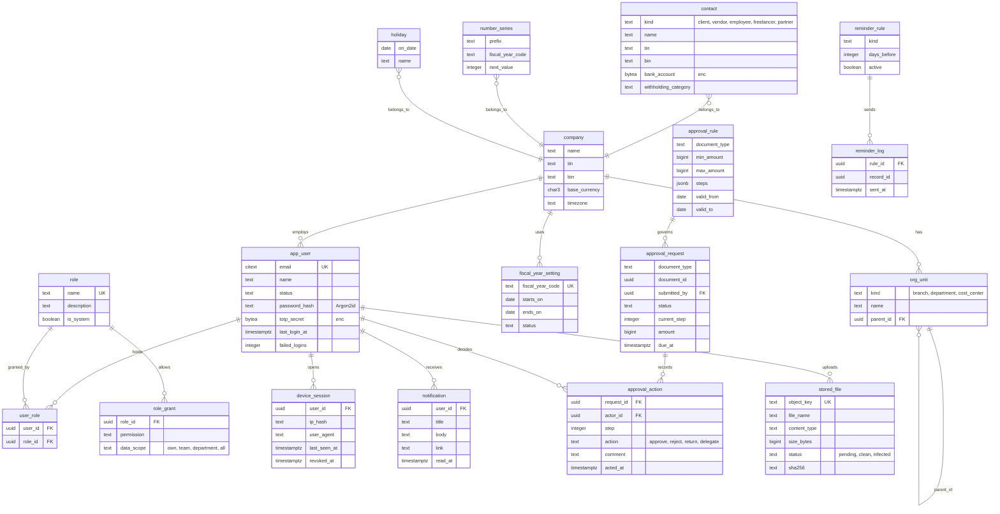
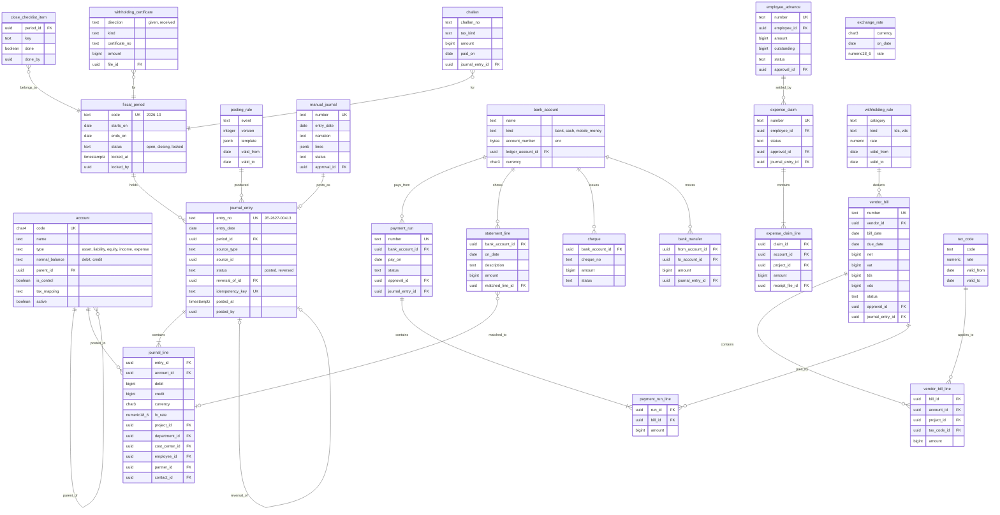
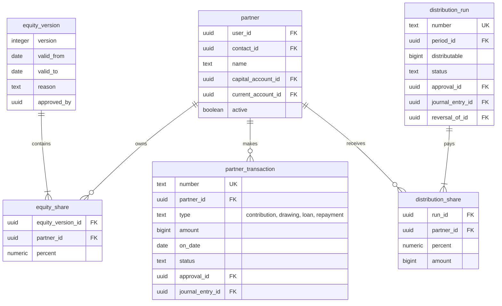
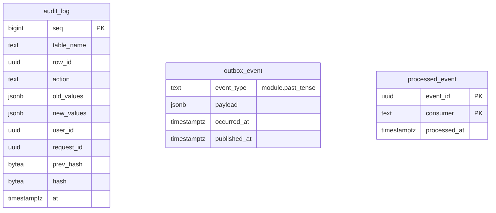
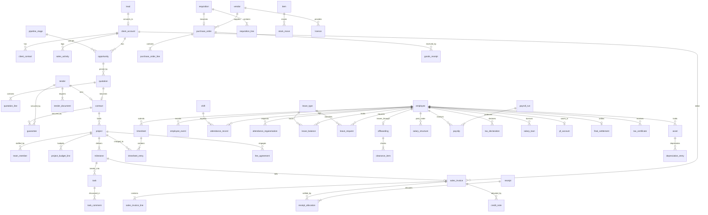

# Database ERD (draft)

**Draft for review at gate G0.** It shows full detail for `core`, `accounting` and `partners`, and entity outlines for the other modules. The outlines gain their columns when each module is designed in Phase 2. [Data architecture](data-architecture.md) holds the rules; if the two disagree, that document wins.

## Conventions

Every table follows these, so the diagrams leave them out.

| Rule             | Columns or behaviour                                                                            |
| ---------------- | ----------------------------------------------------------------------------------------------- |
| Key              | `id uuid` (UUIDv7), generated by the application                                                |
| Tenancy          | `company_id uuid NOT NULL` with row-level security as a second defence                          |
| Audit            | `created_at`, `created_by`, `updated_at`, `updated_by`                                          |
| Optimistic lock  | `version integer`; a stale `If-Match` returns 412                                               |
| Soft delete      | `deleted_at`, on master data only, never on financial or HR records                             |
| Effective dating | `valid_from`, `valid_to`, with an exclusion constraint against overlaps                         |
| Money            | `bigint` poisha, with a `currency char(3)` column wherever more than one currency is possible   |
| Sensitive fields | Envelope-encrypted `bytea`; only a hash is indexed. Marked `enc` below                          |
| Foreign keys     | Real foreign keys, also across schemas. Never a polymorphic `entity_type` and `entity_id` pair¹ |

¹ `journal_entry.source_type` and `source_id`, and the generic attachment and audit references, record where a row came from. They are the exceptions, because their target can be any document.

Immutable tables have no `updated_*` or `version`: `journal_entry`, `journal_line`, `audit_log`, `approval_action`, `equity_share`.

## core

## accounting

The ledger keeps its rules in the database as well as in the posting engine:

1. A deferred constraint trigger rejects any entry whose debits differ from its credits at commit.
2. A trigger rejects inserts dated in a locked period, and any UPDATE or DELETE of posted rows.
3. `app_rw` has no UPDATE or DELETE on `journal_*`.
4. A line has exactly one side: `CHECK ((debit = 0) <> (credit = 0))`.

## partners

Partner money is ledger money: capital, current and due-from balances are always derived from `journal_line` with a `partner_id`, never stored.

## audit and outbox

`audit_log` is append-only and partitioned by month. `outbox_event` is written in the same transaction as the change it announces.

## Entity outlines

The relationships between modules. Columns follow in Phase 2.

### Sensitive columns

Marked by the [access control matrix](../04-security/access-control-matrix.md) and [data classification](../04-security/data-classification.md).

| Table                                            | Columns                                                   |
| ------------------------------------------------ | --------------------------------------------------------- |
| `hr.employee`                                    | `nid`, `tin`, `bank_account`                              |
| `payroll.salary_structure`, `payroll.payslip`    | Every amount per person                                   |
| `core.contact`, `accounting.bank_account`        | Bank account numbers                                      |
| `projects.team_member`, `projects.fee_agreement` | Billing rate and fee, shown as labour cost                |
| Partner balances                                 | Not stored; a field permission guards the derived figures |

## Open questions

1. Should `core.contact` hold clients and vendors, with `crm.client_account` and `procurement.vendor` as extensions? The diagrams assume so.
2. Do `journal_line` foreign keys to other modules' tables stay real foreign keys, given that the module boundary rules forbid cross-module imports? The data architecture says yes, and that is a database dependency only.
3. `manual_journal.lines` is shown as `jsonb`, because a draft is not ledger data. Confirm during Phase 2 design.
4. The chart of accounts and the partner account structure wait for the accountant ([template](../../db/seeds/chart-of-accounts/README.md)).
