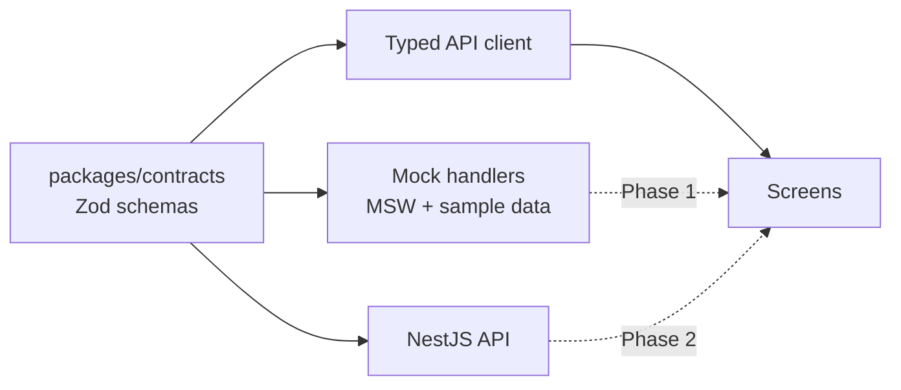

# Frontend architecture

**The web app is built first, completely, against a mock API that serves the shared contracts.** It holds no business rules: totals, tax, posting and permissions are decided by the backend; the UI only displays them and validates input shape.

## Structure

```text
apps/web/
├─ app/                      Next.js App Router
│  ├─ (auth)/                login, 2FA, reset password
│  ├─ (app)/                 authenticated shell
│  └─ bff/v1/[...path]/      backend-for-frontend
│     ├─ home/  approvals/  billing/  finance/  ledger/  partners/
│     ├─ projects/  crm/  hr/  procurement/  reports/  audit/  admin/
├─ features/<module>/        screens, hooks and components per module
├─ lib/api/                  typed client driven by packages/contracts, and the BFF
├─ lib/auth/                 session handling, step-up prompts
├─ mocks/                    Mock Service Worker handlers + seeded sample data
└─ tests/                    Playwright end-to-end specs
```

## How frontend-first works



- The browser calls only the same-origin BFF (`/bff/v1/*`), which forwards known contract endpoints to `API_URL`. `API_MODE=mock` serves those calls from `mocks/` inside the server process; `real` calls the API. `API_REAL_MODULES` switches modules one at a time ([ADR-0008](adr/0008-mock-transport-in-the-bff.md)).
- Mock handlers return realistic sample data that matches the prototype, including error codes (`SOD_VIOLATION`, `PERIOD_LOCKED`) so error states are designed and tested in Phase 1.
- Mocks never implement accounting logic. A mock returns a fixed, pre-computed posting preview; the real calculation is backend work.

## Concerns

| Concern       | Approach                                                                                                                                                                                                                                                                                                                                                        |
| ------------- | --------------------------------------------------------------------------------------------------------------------------------------------------------------------------------------------------------------------------------------------------------------------------------------------------------------------------------------------------------------- |
| Data fetching | TanStack Query; cache invalidated on mutations                                                                                                                                                                                                                                                                                                                  |
| Tables        | TanStack Table with server-side sort, filter, pagination, saved views                                                                                                                                                                                                                                                                                           |
| Forms         | Contract schemas validate every body before it is sent. Sign-in and account use React Hook Form; record create and edit screens use `FormDialog` (`features/common/form-dialog.tsx`), which lists the fields, reshapes what people type (amounts, empty values to null) without calculating anything, and validates with the contract's create or update schema |
| Design system | `packages/ui` on shadcn/ui and Tailwind tokens; light and dark                                                                                                                                                                                                                                                                                                  |
| Money         | One `<Money>` component: `৳1,25,000`, international option, amount in words                                                                                                                                                                                                                                                                                     |
| Permissions   | Render from `allowedActions`; hide routes the role cannot open; never trust the client                                                                                                                                                                                                                                                                          |
| Real time     | Server-sent events for notifications and job progress                                                                                                                                                                                                                                                                                                           |
| i18n          | next-intl; English now, Bangla later; no hard-coded strings                                                                                                                                                                                                                                                                                                     |
| PWA           | Installable, push notifications, camera capture for receipts                                                                                                                                                                                                                                                                                                    |
| Accessibility | Radix primitives, keyboard paths, WCAG 2.1 AA                                                                                                                                                                                                                                                                                                                   |
| Quality       | Storybook for every component; Playwright for every critical journey                                                                                                                                                                                                                                                                                            |

## Frontend security rules

1. No tokens or personal data in `localStorage`, `sessionStorage` or URLs. Sessions are HTTP-only cookies.
2. Strict Content-Security-Policy with nonces; no inline event handlers; no `dangerouslySetInnerHTML` without a sanitiser review.
3. No secrets in `NEXT_PUBLIC_*` variables. Build fails if a known secret pattern appears in the bundle.
4. Sensitive fields (salary, bank, NID) are never fetched for roles without the permission; the API omits them, the UI does not just hide them.
5. Downloads use short-lived signed URLs from the API.
