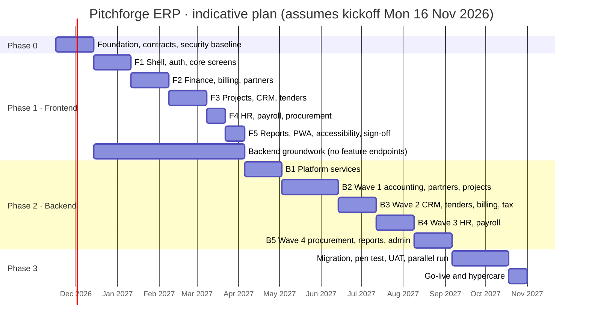

# Roadmap

**The product is built in four phases: foundation and contracts, then the complete frontend on a mock API, then the backend in four waves, then integration, hardening and go-live.** With the team in the [project overview](../00-project-overview.md), the plan runs about 50 weeks. Every phase ends at a gate that the Partners sign.

## Phases and gates

| Phase                                                        | Weeks | Outcome                                                                                             | Gate (signed by Partners)                                          |
| ------------------------------------------------------------ | ----- | --------------------------------------------------------------------------------------------------- | ------------------------------------------------------------------ |
| [0 · Foundation](phase-0-foundation.md)                      | 1–4   | Repo, CI, design system, **contracts v1 for every module**, mock server, security baseline, staging | **G0** Contracts reviewed; CI and security scans green             |
| [1 · Frontend](phase-1-frontend.md)                          | 5–20  | Every screen built and tested on the mock API                                                       | **G1** UI signed off on staging; contracts frozen                  |
| [2 · Backend](phase-2-backend.md)                            | 21–42 | Platform services, then four waves of modules implementing the frozen contracts                     | **G2-W1…W4** Contract tests and golden datasets pass for each wave |
| [3 · Integration and go-live](phase-3-integration-golive.md) | 43–50 | Data migration, pen test, performance test, UAT, one-month parallel run, go-live                    | **G3** No open high/critical findings · **G4** Go-live approved    |

## Rules of the plan

1. **Frontend first, but on contracts.** No screen is built without its contract in `packages/contracts`. See [ADR-0002](../02-architecture/adr/0002-frontend-first-contract-first.md).
2. **No business rules in the frontend or mocks.** Totals, tax, posting and permissions are backend work; mocks return fixed results.
3. **Contract freeze at G1.** After sign-off, a contract change is a change request with an estimate.
4. **Backend groundwork during Phase 1.** Backend developers build what does not depend on UI decisions: database schema, migrations, the ledger and posting-engine core with tests, infrastructure and security foundations. Feature endpoints start in Phase 2.
5. **Security gates in every phase**, listed in [security gates](../04-security/security-gates.md).
6. **Two-week sprints**, demo to Partners at the end of each.

## Trade-off to manage

Frontend-first means the first production go-live is later than a module-by-module plan. If an earlier go-live is needed, Wave 1 (accounting, partners, projects) can go live after B2 with a reduced Phase 3 for those modules (pen test of W1 scope, two-week parallel run), around week 33.

## Team load

| Role           | Phase 0                     | Phase 1                            | Phase 2                                | Phase 3                |
| -------------- | --------------------------- | ---------------------------------- | -------------------------------------- | ---------------------- |
| Frontend (2)   | Design system, shell        | **All screens**                    | Switch mocks to real API, fixes        | Fixes, UAT support     |
| Backend (2)    | **Contracts**, schema draft | Groundwork: DB, ledger core, infra | **All endpoints**                      | Migration, performance |
| QA (1)         | Test plan                   | E2E on mocks                       | Contract, integration, golden datasets | UAT, regression        |
| Designer (0.5) | Tokens, key screens         | Screen designs ahead of sprints    | Polish                                 | —                      |
| BA (0.5)       | Contracts with backend      | Acceptance criteria                | Golden datasets with accountant        | UAT, training          |
