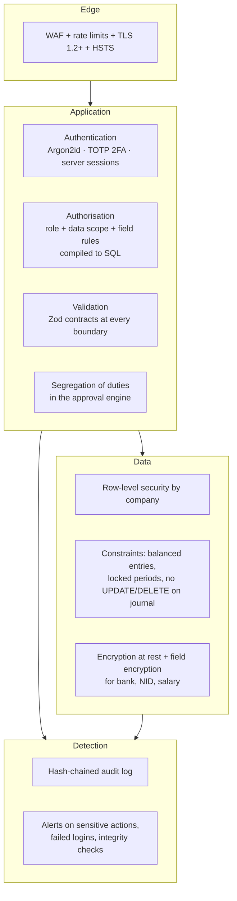

# Security architecture

**Target: OWASP ASVS Level 2, verified by an external penetration test before go-live.** Security is layered so that one failure does not expose data: the network admits only the load balancer, the API denies what no policy allows, the database refuses what the API should never do, and every action is recorded.

## 1. Identity and sessions

| Control          | Detail                                                                                                                |
| ---------------- | --------------------------------------------------------------------------------------------------------------------- |
| Passwords        | Argon2id; minimum 12 characters; checked against breached-password lists; no forced periodic rotation                 |
| Two-factor       | TOTP mandatory for Partner, Finance, HR and Admin; optional for others; recovery codes shown once                     |
| Sessions         | Opaque ID in HTTP-only, Secure, SameSite=Lax cookie; stored in Redis; idle 60 min, absolute 12 h                      |
| Revocation       | All sessions revoked on password change, role change, deactivation; admin can force sign-out                          |
| Step-up          | Re-enter password or TOTP for partner drawings, payroll lock, bank detail changes, role changes, period reopen        |
| Login protection | Rate limit per IP and account; progressive delay; lockout after 10 failures; alert on new device for privileged roles |
| Integrations     | Scoped, expiring personal access tokens; never browser sessions                                                       |

## 2. Authorisation

- **Deny by default.** Every endpoint has an explicit policy; an endpoint without one fails a CI check.
- **Three layers in one policy:** role (what actions), data scope (own, team, department, project, all), field rules (salary, bank, NID, partner balances).
- **Compiled to SQL** so lists, search, exports, reports and notifications are filtered in the database, not after loading.
- **Segregation of duties** is a domain rule: requester ≠ approver; payee ≠ approver; creator of a payment run ≠ its approver.
- **Row-level security** by `company_id` as a second line of defence.
- Matrix: [access control matrix](access-control-matrix.md).

## 3. Data protection

| Data                      | At rest                                                         | In transit               | Who can read                                         |
| ------------------------- | --------------------------------------------------------------- | ------------------------ | ---------------------------------------------------- |
| All database data         | Disk encryption (KMS)                                           | TLS                      | Per policy                                           |
| Bank account, NID, salary | Plus application-level envelope encryption; only hashes indexed | TLS                      | Field permission only; API omits the field otherwise |
| Files                     | S3 server-side encryption, private bucket, versioning           | TLS, signed URLs (5 min) | Per record policy                                    |
| Backups                   | Encrypted, copied to a second region, object lock               | —                        | DevOps break-glass only                              |
| Logs                      | Encrypted; PII masked before writing                            | TLS                      | Engineering on-call                                  |

Classification rules: [data classification](data-classification.md).

## 4. Application hardening

- Zod validation at every boundary; parameterised SQL only; no string-built queries.
- CSRF protection on cookie-authenticated writes (`Sec-Fetch-Site` and `Origin` checked in the BFF, `SameSite=Lax` cookie); strict CSP with nonces; `X-Content-Type-Options`, `Referrer-Policy`, `Permissions-Policy`, `frame-ancestors 'none'`.
- File uploads: type and size checked, stored outside web root, ClamAV scan before the file is downloadable, served with `Content-Disposition: attachment`.
- Idempotency keys on every money-moving command; optimistic locking against lost updates.
- Errors return a stable code and a request id; never stack traces or SQL.
- Rate limits on login, exports, PDF generation and search.

## 5. Secrets and infrastructure

- Secrets in AWS Secrets Manager; injected at runtime; rotated yearly or on staff exit; never in the repository, images or logs.
- Least-privilege database roles: `app_rw` (no DDL, no UPDATE/DELETE on journal and audit), `app_migrate` (CI only), `report_ro` (replica).
- Private subnets for containers and data; only the load balancer is public; no SSH; access via SSO-backed session manager with MFA.
- Container images: minimal base, non-root user, read-only filesystem, scanned in CI.
- Infrastructure as code (Terraform) reviewed like application code.

## 6. Supply chain

- Lockfile committed; `pnpm install --frozen-lockfile` in CI.
- Dependency audit blocks high and critical issues; Renovate for updates with review.
- Gitleaks on every push; GitHub secret scanning and push protection on.
- Signed commits on `main`; branch protection with required checks.

## 7. Detection and response

- Hash-chained audit log for every change, login and export.
- Alerts: repeated failed logins, new-device login for privileged roles, role changes, period reopen, large drawings or payments, audit chain failure, unusual export volume.
- [Incident response](incident-response.md) plan with severities and contacts.

## 8. Verification

| When                | What                                                         |
| ------------------- | ------------------------------------------------------------ |
| Every pull request  | Secret scan, dependency audit, static analysis, policy tests |
| Every sprint        | Security review of new endpoints and screens                 |
| Each wave (G2)      | Role-by-role access tests; DAST scan on staging              |
| Before go-live (G3) | External penetration test (ASVS L2); DR drill                |
| Every year          | Pen test, access review, key rotation, policy review         |
